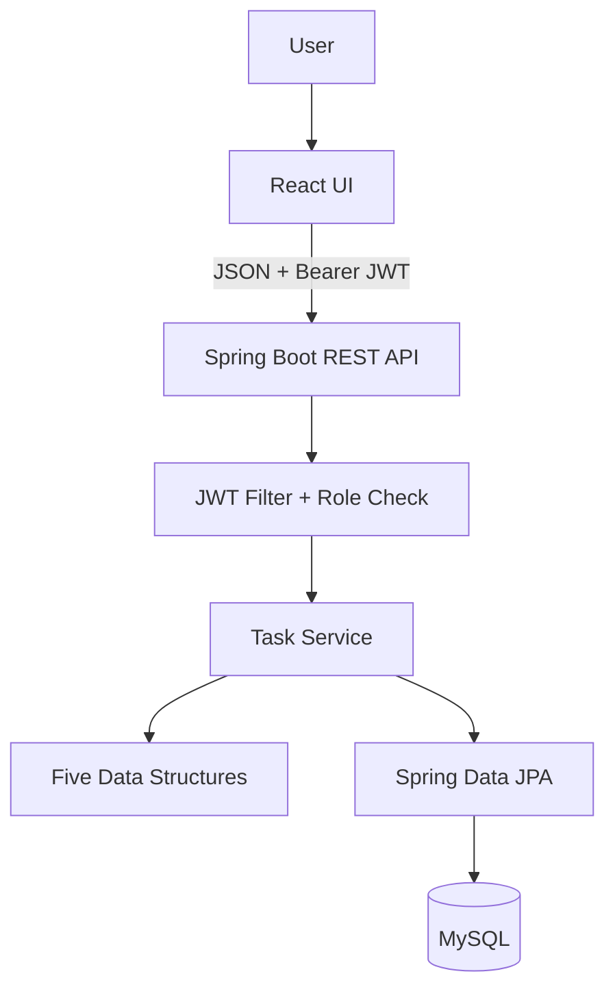

# CampusFlow — Minimal Full-Stack Task Manager

A small, interview-friendly implementation of the features listed in the resume: Java, Spring Boot, React, MySQL, JWT, role-based access, and five data structures.

## Important project status
This is a **minimal learning/demo implementation**, not a production-ready SaaS product. The core task CRUD, data-structure demonstrations, and simple JWT login flow are implemented. Calendar scheduling is represented by task due dates; recurrence and notifications are basic extension points, not a delivery-grade scheduler/notification service. Run and test the code before claiming it works on your machine.

## Architecture



## Feature-to-code map

| Resume item | Minimal implementation |
|---|---|
| Spring Boot REST APIs | `TaskController`, `AuthController` |
| React frontend | `frontend/src/App.jsx` |
| MySQL + JPA/Hibernate | `Task` entity and `TaskRepository` |
| Deadlines / calendar scheduling | `Task.dueDate`, shown in task list |
| Recurring tasks | `recurrence` enum stored with task (no background recurrence engine) |
| Dependencies | `DependencyGraph` prevents cycles; demo endpoint |
| Priority scheduling | `TaskPriorityQueue` min-heap; demo endpoint |
| Autocomplete | `TaskTrie` prefix lookup; demo endpoint |
| Undo/Redo | `UndoRedoStack` with two stacks; demo endpoint |
| Recently viewed tasks | `LruCache` with map + doubly linked list; demo endpoint |
| JWT authentication | `/api/auth/login`, signed JWT, request filter |
| Role-based access | `USER` and `ADMIN` role claim; admin-only endpoint |

## Quick start

### Requirements
- Java 17+
- Maven 3.9+
- Node.js 18+
- MySQL 8+

### Database
```sql
CREATE DATABASE campusflow;
```

Set environment variables (or edit `backend/src/main/resources/application.properties` for local use):
```bash
DB_URL=jdbc:mysql://localhost:3306/campusflow
DB_USERNAME=root
DB_PASSWORD=your_mysql_password
JWT_SECRET=replace-this-with-a-long-random-secret-key-at-least-32-characters
```

### Backend
```bash
cd backend
mvn spring-boot:run
```
Runs at `http://localhost:8080`.

### Frontend
```bash
cd frontend
npm install
npm run dev
```
Runs at `http://localhost:5173`.

Demo login:
- username: `admin`
- password: `admin123`
- role: `ADMIN`

This demo account is hard-coded for local interview demonstration only. Replace it with database-backed users and hashed passwords in a real application.

## API examples

Login:
```http
POST /api/auth/login
Content-Type: application/json

{"username":"admin","password":"admin123"}
```
Response includes a JWT token. Send it on protected calls:
```http
Authorization: Bearer <token>
```

Create task:
```http
POST /api/tasks
Authorization: Bearer <token>
Content-Type: application/json

{
  "title":"Prepare interview",
  "priority":"HIGH",
  "status":"TODO",
  "dueDate":"2026-11-03",
  "recurrence":"NONE"
}
```

Useful endpoints:
- `GET /api/tasks`
- `POST /api/tasks`
- `GET /api/tasks/{id}`
- `PUT /api/tasks/{id}`
- `DELETE /api/tasks/{id}`
- `GET /api/demo/priority`
- `GET /api/demo/autocomplete?prefix=co`
- `POST /api/demo/dependencies` with `{"from":1,"to":2}`
- `POST /api/demo/undo` with `{"action":"CREATE_TASK"}`
- `POST /api/demo/recent` with `{"id":12,"value":"Design API"}`

`GET /api/admin/ping` requires the `ADMIN` role.

## Why these five data structures?

1. **Priority Queue:** tasks with high priority should be considered before low-priority tasks. A binary heap makes insert/remove efficient: O(log n), peek O(1).
2. **Graph:** tasks can depend on other tasks. A directed edge A → B means B depends on A. DFS checks whether a new edge would create a cycle: O(V + E).
3. **Trie:** prefix search is useful for task-title autocomplete. Insert/search takes O(L), where L is title/prefix length.
4. **Two Stacks:** undo and redo are naturally LIFO. Push/pop is O(1).
5. **LRU Cache:** recently opened tasks are likely to be opened again. HashMap + doubly linked list gives O(1) average get/put.

## Security note
This is a compact demonstration: one hard-coded demo user, a shared JWT secret from configuration, and simple role claims. For production, use database-backed users, BCrypt password hashing, strong secret management, token expiry/refresh strategy, HTTPS, ownership checks, validation, and tests.

## Interview explanation
“CampusFlow is a task manager built with React and Spring Boot. The frontend calls REST endpoints. Spring Boot handles validation and business logic, JPA stores tasks in MySQL, and JWT protects API calls. I used a priority queue for task ordering, a graph for dependencies and cycle detection, a trie for autocomplete, two stacks for undo/redo, and an LRU cache for recently viewed tasks. I kept the implementation small so each data structure has a clear responsibility.”

## 3-hour preparation plan
See [`docs/3-hour-plan.md`](docs/3-hour-plan.md).
